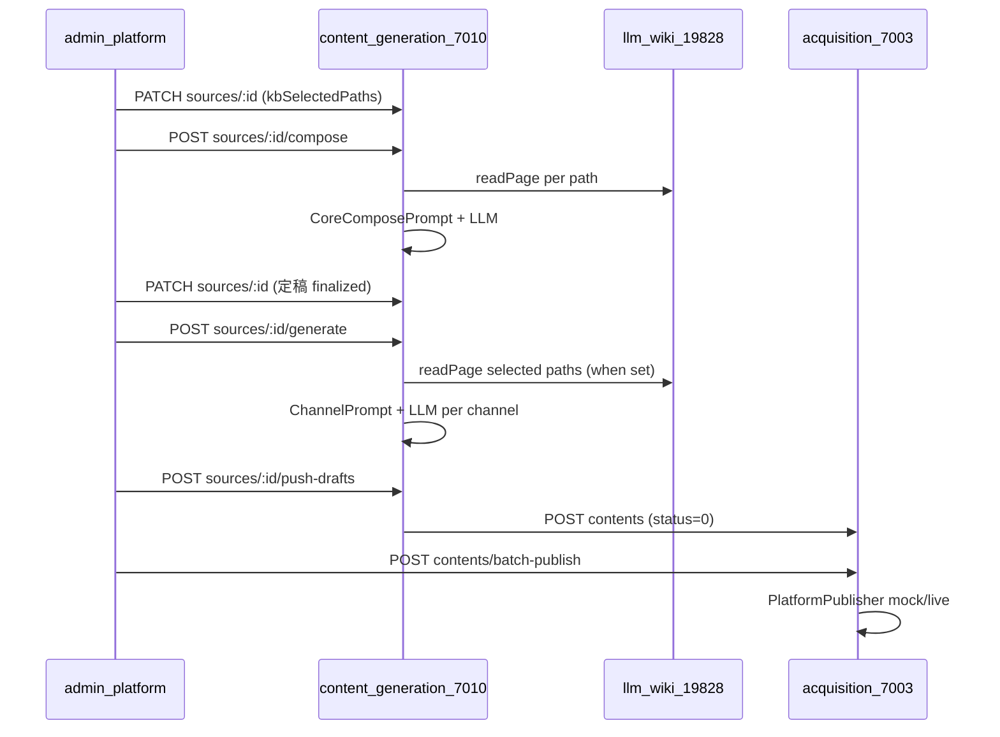

# Studio 运行契约 — AI 原生创作中心

> **状态：** 与实现同步（2026-06-09）  
> **关联计划：** [多平台内容生成服务](../plans/2026-06-04-content-generation-service.md) · [AI 原生个人创作中心](../plans/2026-06-05-ai-native-creation-center.md) · [用户流程对齐](../plans/2026-06-09-content-studio-wiki-compose-flow.md)

## 三层架构

| 层 | 组件 | 端口/位置 | 职责 |
|----|------|-----------|------|
| 知识层 | LLM Wiki 桌面 App | `127.0.0.1:19828` | wiki 检索、读页、图谱 |
| 核心层 | `content-generation-service` | `7010` | 核心内容源、wiki 选材、核心稿合成、多渠道生成 |
| 外围层 | `acquisition-service` | `7003` | 草稿 CRUD、平台 OAuth token、发布 |

入口 UI：`admin-platform` → **创作中心**（`/content-studio`），4 步向导：选材 → 合成 → 定稿 → 发布。

## 本地依赖

1. **LLM Wiki App 运行**，且 Settings → API + MCP 已生成 Token
2. **PostgreSQL + Redis**（docker compose）
3. **Gateway** `7000` 路由：
   - `/api/v1/content-studio/*` → 7010
   - `/api/v1/acquisition/*` → 7003

## 环境变量

| 变量 | 服务 | 说明 |
|------|------|------|
| `LLM_WIKI_BASE_URL` | content-generation | 默认 `http://127.0.0.1:19828` |
| `LLM_WIKI_API_TOKEN` | content-generation | llm-wiki Bearer Token |
| `LLM_WIKI_PROJECT_ID` | content-generation | 默认 `current` |
| `LLM_API_BASE` / `LLM_API_KEY` / `LLM_MODEL` | content-generation | OpenAI 兼容生成端点 |
| `ACQUISITION_SERVICE_URL` | content-generation | push-draft 内部调用 |
| `XHS_PUBLISH_MODE` | acquisition | `mock`（默认）或 `live` |
| `PLATFORM_PUBLISH_MODE` | acquisition | 抖音/微信/X mock 发布 |
| `CONTENT_GENERATION_SYNC` | content-generation | `true` 时跳过 Bull，同步生成 |
| `CONTENT_GENERATION_MOCK_LLM` | content-generation | `true` 时 E2E/本地不调用真实 LLM |

Docker 内 CGS 访问宿主机 llm-wiki 时使用 `http://host.docker.internal:19828`。

已有 DB volume 需执行 migration：`code/scripts/migrations/2026-06-09-content-source-kb-paths.sql`。

## 创作流水线



## 内容状态（acquisition.content.status）

| 值 | 含义 |
|----|------|
| `0` | 草稿 |
| `1` | 已发布 |
| `2` | 失败 |
| `3` | 发布中 |

## 关键 API

### 内容工坊（经 gateway）

- `GET/POST/PATCH/DELETE /api/v1/content-studio/sources`
- `POST /api/v1/content-studio/sources/:id/compose` — wiki → 核心稿
- `POST /api/v1/content-studio/sources/:id/generate`
- `POST /api/v1/content-studio/sources/:id/push-drafts` — 批量推送草稿
- `GET /api/v1/content-studio/kb/health`
- `POST /api/v1/content-studio/kb/search`
- `POST /api/v1/content-studio/kb/read-pages`
- `POST /api/v1/content-studio/variants/:id/push-draft` — 单条推送（兼容）

### 获客 / 发布

- `POST/GET /api/v1/acquisition/contents`
- `POST /api/v1/acquisition/contents/:id/publish`
- `POST /api/v1/acquisition/contents/batch-publish` — 逐项发布，失败不 rollback
- `GET /api/v1/acquisition/contents/:id/publish-status`
- `GET /api/platform-account/list?platform=...` — 发布 Step 账号选择
- `POST /api/platform-account/:id/oauth` — 账号管理页配置 token

## 失败模式

| 现象 | 原因 | 处理 |
|------|------|------|
| KB 503 / 检索空 | llm-wiki 未运行或未配 Token | 启动 App；设置 `LLM_WIKI_API_TOKEN` |
| compose 502 | readPage 失败 | 检查 path 是否存在 |
| 生成失败 | LLM 端点/Key 无效 | 检查 `LLM_*` |
| 发布 401 | 平台账号无 token | 在账号管理页配置 OAuth token |
| `XHS live publish is not configured` | `XHS_PUBLISH_MODE=live` 但未接 Open API | 本地用 `mock` |

## 验证命令（示例）

```bash
# KB 健康
curl -s http://127.0.0.1:19828/api/v1/health

# 保存选材 paths（需登录 Token）
curl -s -X PATCH -H "Authorization: Bearer $JWT" \
  -H "Content-Type: application/json" \
  -d '{"kbSelectedPaths":["notes/topic-a.md"]}' \
  http://localhost:7000/api/v1/content-studio/sources/1

# E2E harness
cd code && CONTENT_GENERATION_SYNC=true CONTENT_GENERATION_MOCK_LLM=true \
  PLATFORM_PUBLISH_MODE=mock pnpm test:e2e:content-studio
```

---

**更新日期：** 2026-06-09
