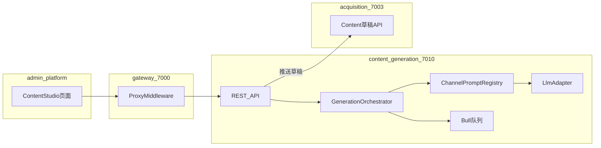
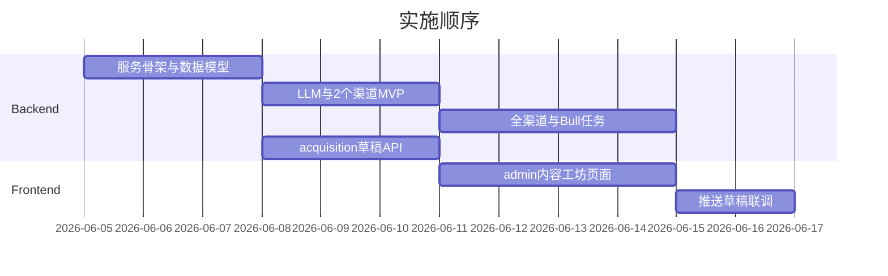

# 多平台内容生成服务实施计划

> **状态：** 实施中（P0–P3 已完成；E2E harness 已补全；live LLM/平台 API 待办）  
> **创建日期：** 2026-06-04  
> **概述：** 在 open-scrm monorepo 新增第 11 个微服务 `content-generation-service`（端口 7010），以「核心内容源」为单一事实源，经可配置的渠道 Prompt 管线一键生成多平台形态，并在 admin-platform 提供运营界面，生成结果可推送为 acquisition-service 的发布草稿。  
> **参照：** [dbskill](https://github.com/dontbesilent2025/dbskill)

---

## 实施清单

- [x] 新增 `content-generation-service`（7010）：Midway 脚手架、TypeORM 三表、gateway/docker/turbo 接线
- [x] 实现 `LlmAdapter` + `ChannelPromptRegistry` + `GenerationOrchestrator`（Bull 并行多 channel）
- [x] 实现 content-studio REST API（严格 DTO）+ `docs/services` 文档与端口表更新
- [x] `acquisition-service` 新增 Content CRUD/草稿 API；cgs `push-draft` 内部调用
- [x] admin-platform：内容工坊列表/编辑/生成/变体/推送草稿页面与菜单
- [x] curl + 可选 Playwright：登录 → 创建源 → 生成 → 推送草稿链路；更新 harness 说明

---

## 背景与参照

- **仓库现状**：10 个 Midway 微服务（7000–7009），**无** LLM/生成能力；[`acquisition-service` 的 `ContentEntity`](../../code/services/acquisition-service/src/entity/content.entity.ts) 仅建模「平台发布内容」，尚无 Controller/发布 API。
- **[dbskill](https://github.com/dontbesilent2025/dbskill)**：Agent **Skills + 知识包**（诊断为主，如 `dbs-content` 明确「不代写」）。本方案取其**平台匹配、五维质量、hook/xhs-title/ai-check 等方法论**，落地为**服务端 Prompt 模板与后处理步骤**，而非整包安装 Skills。
- **许可证**：dbskill 为 [CC BY-NC 4.0](https://creativecommons.org/licenses/by-nc/4.0/)。商业产品内**不宜直接嵌入**其 `知识库/` 全文；应**自研 Prompt**（可参考公开方法论结构），对外文档注明灵感来源；若需引用原文须署名或取得商业授权。

## 目标架构



**职责边界**

| 模块 | 职责 |
|------|------|
| `content-generation-service` | 核心源 CRUD、生成任务、各渠道变体存储、质量后处理、推送到获客草稿 |
| `acquisition-service` | 平台账号、渠道、**发布态**内容（草稿/已发布），对接未来抖音/小红书 Open API |
| admin-platform | 录入核心源、勾选渠道、触发生成、编辑变体、一键推送草稿 |

> **产品注记**：MVP 需求里「运营人员 / 多平台发布」更贴近 [`operation-platform`](../../code/apps/operation-platform)；第一期在 **admin-platform** 实现；后续可将同一页面复用到 operation 侧菜单（小改动）。

## 渠道与输出形态（第一期）

在共享常量中定义稳定枚举（与文档、API Schema 一致）：

| `channel` | 输出结构要点 | dbskill 启发 |
|-----------|----------------|--------------|
| `short_video_script` | 分镜/口播稿、前 3s hook、时长建议 | `dbs-hook` 式开头强化（生成后可选二次 pass） |
| `long_video_script` | 章节大纲 + 完整旁白 | 长逻辑链形式 |
| `wechat_article` | 标题、摘要、Markdown 正文、封面建议 | 深度文章 |
| `xhs_graphic` | 标题（≤20字）、正文、标签、分页要点（大字报式 bullet） | `dbs-xhs-title` 公式可作 title 子步骤 |
| `tweet` | 单条或 thread（≤280/条） | X 文字平台 |
| `douyin_caption` | 标题（≤30）、文案（≤1000）、话题 | 对齐 [需求规格](../mvp/需求规格说明书.md) 抖音字段 |

一键生成 API：`channels[]` 非空则**并行**调用 LLM（Bull 任务聚合状态），全部完成后 `job.status = succeeded`。

## 数据模型（PostgreSQL，`scrm_dev`）

新增迁移（可放在 [`code/scripts/init-db.pg.sql`](../../code/scripts/init-db.pg.sql) 增量段或独立 migration 脚本，与现有 TypeORM `synchronize` 策略对齐）：

1. **`content_source`** — 核心内容源  
   - `id`, `corp_id`, `title`, `body` (text/markdown), `summary`, `keywords` (json), `tone`, `target_audience`, `create_user_id`, timestamps  
   - 索引：`corp_id + updated_at`

2. **`generation_job`** — 一次批量生成  
   - `source_id`, `channels` (json), `status` (pending/running/succeeded/failed), `error_message`, `llm_model`, `prompt_version`, timestamps

3. **`content_variant`** — 单渠道产出  
   - `job_id`, `source_id`, `channel`, `title`, `body` (text), `structured` (json，存分镜/thread/标签等), `quality_flags` (json，如 ai_check_passed), `version`, timestamps

4. **`variant_publish_link`**（可选）— 变体 → acquisition `content.id` 映射，便于回查

多租户：所有写操作经 [`getTenantContext`](../../code/packages/server-common/src/util/tenant-context.ts) 取 `corpId`（与现有服务一致）。

## API 契约（经 gateway，`/api/v1/content-studio/*`）

严格 DTO（`@midwayjs/validate`，未知字段拒绝），错误体带 `requestId`（沿用 server-common 模式）。

| 方法 | 路径 | 说明 |
|------|------|------|
| POST | `/api/v1/content-studio/sources` | 创建核心源 |
| GET/PATCH/DELETE | `/api/v1/content-studio/sources/:id` | 列表/详情/更新/删除 |
| POST | `/api/v1/content-studio/sources/:id/generate` | Body: `{ channels: Channel[] }` → 返回 `jobId` |
| GET | `/api/v1/content-studio/jobs/:id` | 任务状态 + `variants[]` |
| GET/PATCH | `/api/v1/content-studio/variants/:id` | 查看/人工修订生成结果 |
| POST | `/api/v1/content-studio/variants/:id/push-draft` | Body: `{ platform, accountId?, contentType }` → 调用 acquisition 写草稿 |

**推送草稿**：在 acquisition-service **新增** `ContentController` + `ContentService`（当前仅有 Entity），例如 `POST /api/v1/acquisition/contents`，将 variant 的 `title`/`body`/`topics` 映射到 [`ContentEntity`](../../code/services/acquisition-service/src/entity/content.entity.ts)（`status=0` 草稿）。content-generation-service 通过 `@midwayjs/axios` 调内部 URL（`ACQUISITION_SERVICE_URL`）。

## 新服务：`content-generation-service`（7010）

**脚手架**：复制 [`message-service`](../../code/services/message-service) 依赖面（Koa、TypeORM、Redis、axios、**Bull**），端口见同目录 `config.default.ts` 模式。

**核心模块**

```
code/services/content-generation-service/src/
  controller/   content-source.controller.ts, generation.controller.ts, variant.controller.ts
  service/      content-source.service.ts, generation-orchestrator.service.ts, variant.service.ts
  service/      acquisition-client.service.ts
  service/      llm/llm.adapter.ts          # OpenAI-compatible: baseURL + apiKey + model from env
  prompt/       channel-prompt.registry.ts  # 每 channel 的 system/user 模板 + 变量注入
  prompt/       post-process/               # 可选：ai_check 规则化扫描、hook 强化
  entity/       ...
  dto/          ...
```

**环境变量**（写入 [`docs/guides/环境配置说明.md`](../guides/环境配置说明.md)）：

- `LLM_API_BASE`, `LLM_API_KEY`, `LLM_MODEL`（默认如 `gpt-4o-mini` 或国内兼容端点）
- `ACQUISITION_SERVICE_URL`
- `CONTENT_PROMPT_VERSION`（便于 Prompt 迭代与 job 追溯）

**共享包（建议）**：新增 `code/packages/content-prompts` 或在服务内 `src/prompt/`，仅放模板与 JSON Schema 导出；避免把 dbskill 知识库二进制入库。

**网关与 Compose**

- [`gateway-service/src/config/config.default.ts`](../../code/services/gateway-service/src/config/config.default.ts)：增加 `path: '/api/v1/content-studio/*'`, `target: CONTENT_GENERATION_SERVICE_URL`
- [`code/docker-compose.yml`](../../code/docker-compose.yml)：`content-generation-service` 容器 + `x-gateway-env` 增加 `CONTENT_GENERATION_SERVICE_URL: http://content-generation-service:7010`
- admin-platform `ServiceMonitor`：登记 7010

**Turbo**：根 `code/package.json` workspace 已含 `services/*`，新服务自动纳入 `pnpm build` / `type-check`。

## Prompt 管线设计（借鉴 dbskill，面向「生成」）

与 dbskill「诊断不写稿」相反，本服务 **默认生成 + 可选质检**：

1. **形式路由（轻量）**：根据 `source.summary/keywords` 在 orchestrator 内选择是否建议额外 channel（仅 warning，不阻断）。
2. **Per-channel 生成**：`ChannelPromptRegistry` 注入核心源 + 平台约束（字数、结构）。
3. **后处理链（可配置）**  
   - 全渠道：`ai_check` 规则扫描（22 条特征可先做子集正则/LLM 二次 pass）  
   - `short_video_script`：额外 hook pass  
   - `xhs_graphic`：title pass（公式化候选 3 选 1 再写入 `structured.titles`）

Prompt 版本写入 `generation_job.prompt_version`，便于 A/B 与回归。

## admin-platform UI

在 [`code/apps/admin-platform`](../../code/apps/admin-platform) 新增：

- 路由：`/content-studio`、`/content-studio/:sourceId`
- 视图：`ContentStudioList.vue`（源列表）、`ContentStudioEditor.vue`（左侧核心源编辑，右侧渠道勾选 + 「一键生成」+ 变体 Tab）
- API 封装：扩展 `src/utils/api.ts`
- 菜单：`MainLayout.vue` 增加「内容工坊」

交互要点：生成轮询 `job` 状态；变体支持 Markdown 预览；「推送草稿」弹窗选择 `platform` + `accountId`（账号列表可调 acquisition 已有 platform-account API）。

## 文档与契约同步

- 新建 `docs/services/content-generation-service/README.md` — API、渠道枚举、环境变量、与 acquisition 集成
- 更新 [`docs/开发计划.md`](../开发计划.md) 端口表（7010）
- 可选：导出请求体 JSON Schema 到 `docs/api/content-studio/`（若仓库已有 drift 检查则一并接入）

## 分阶段交付（建议 PR 切分）



| 阶段 | 交付物 | 验证 |
|------|--------|------|
| P0 | 7010 服务 + DB 表 + gateway + docker + 2 渠道（如 `tweet` + `xhs_graphic`） | `curl` 经 gateway 创建源并 generate |
| P1 | 全 6 渠道 + Bull 异步 + ai_check 基础 | 单测 orchestrator mock LLM |
| P2 | acquisition `ContentController` + push-draft | E2E：生成 → 推送 → GET 草稿 |
| P3 | admin-platform 内容工坊完整 UX | 浏览器手测 + 更新 harness 文档 |

## 风险与决策

- **LLM 成本/延迟**：Bull 限流 + 按 `corp_id` 并发上限（Redis key）。
- **生成质量**：第一期不追求 dbskill 级诊断 UI；用 `quality_flags` 暴露 ai_check 结果，运营可人工改 variant 再推送。
- **admin vs operation**：第一期做 admin；若运营反馈路径过长，第二期在 operation-platform 增加入口链接同一 API。

## 关键参考文件

- 网关路由：[`code/services/gateway-service/src/config/config.default.ts`](../../code/services/gateway-service/src/config/config.default.ts)
- 发布实体：[`code/services/acquisition-service/src/entity/content.entity.ts`](../../code/services/acquisition-service/src/entity/content.entity.ts)
- 前端 API 模式：[`code/apps/admin-platform/src/utils/api.ts`](../../code/apps/admin-platform/src/utils/api.ts)
- 协作索引：[`docs/README.md`](../README.md)、[`AGENTS.md`](../../AGENTS.md)

---

**更新日期：** 2026-06-04
