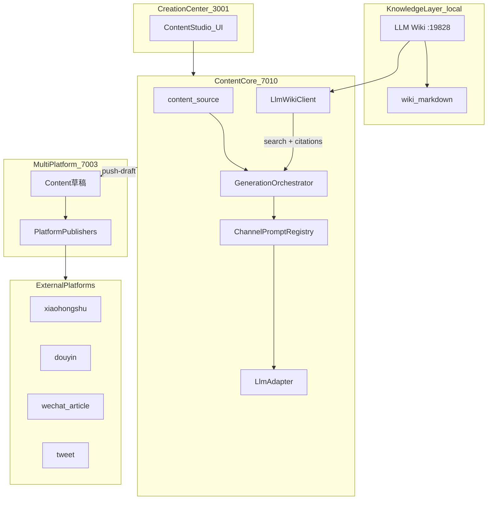
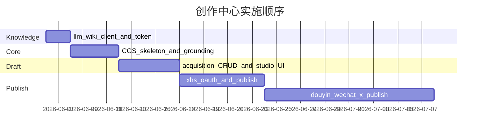

# AI 原生个人创作中心 — 架构与实施计划

> **状态：** 实施中（P0–P5 主体完成；P4 live API 与 E2E 待办）  
> **创建日期：** 2026-06-05  
> **概述：** 在 open-scrm 上构建「llm-wiki 知识库 → 内容系统核心 → 多平台生成/发布外围」三层架构的个人 AI 原生创作中心。本地优先：llm-wiki 跑在本机 `:19828`；目标闭环为检索 grounding → 核心内容源 → 多平台变体 → 草稿 → 平台发布 API。  
> **扩展：** 本计划扩展 [多平台内容生成服务](./2026-06-04-content-generation-service.md)，新增 llm-wiki 知识层与发布闭环。

---

## 实施清单

- [ ] 在 LLM Wiki App 生成 API Token，配置 `LLM_WIKI_API_TOKEN` 环境变量（需用户本地操作）
- [x] 新增 `packages/llm-wiki-client`：`health` / `search` / `readPage` / `graph` 封装
- [x] 搭建 `content-generation-service`（7010）：数据模型、gateway、KB grounding 管线
- [x] `acquisition-service` 实现 Content CRUD + `push-draft` 映射
- [x] `admin-platform` 创作中心 UI：源编辑、KB 检索、生成、变体、citations
- [x] 首平台闭环：小红书 OAuth + publish API + E2E（mock 模式）
- [x] 扩展抖音、微信公众号、X 发布 Adapter（mock 模式，按 P4 逐个）
- [x] 编写 `docs/facts/studio.md` 与 API 契约文档

---

## 愿景

把 **llm-wiki**（个人知识库）、**内容系统**（核心内容源 + 生成编排）、**多平台内容服务**（渠道变体 + 发布）串成一条 AI 原生创作流水线：



**单一事实源原则**

- **知识**：llm-wiki 的 wiki 页面（检索 + 引用），不复制全文进 DB
- **创作**：`content_source` 是「本次要表达什么」的核心源
- **分发**：`content_variant` 是各平台形态；`acquisition.content` 是发布态草稿/已发布记录

---

## 现状与缺口（已核实）

| 能力 | 状态 |
|------|------|
| llm-wiki 本地 API | 运行中 v0.4.20，**需配置 Token** 才能调业务接口 |
| [content-generation-service](./2026-06-04-content-generation-service.md) | **仅文档，无代码** |
| [ContentEntity](../../code/services/acquisition-service/src/entity/content.entity.ts) | 有表/实体，**无 Controller/API** |
| 平台 OAuth / 发布 API | **未实现**（Douyin/XHS/WeChat/X） |
| admin-platform 内容工坊 UI | **未实现** |

本计划 **扩展** 已有 [多平台内容生成服务](./2026-06-04-content-generation-service.md)，新增 **llm-wiki 知识层** 与 **发布闭环**，不重复其渠道枚举/Prompt 设计细节。

---

## 三层职责

### 1. 知识层 — llm-wiki（本地）

- **部署**：本机桌面 App，API `http://127.0.0.1:19828`
- **集成方式**：HTTP JSON API（不用 MCP 作为主路径，便于服务端 `axios` 调用）
- **前置条件**：Settings → API + MCP → 生成 Token，写入 `LLM_WIKI_API_TOKEN`

**封装**：新增共享包 [`code/packages/llm-wiki-client`](../../code/packages/llm-wiki-client)（或 CGS 内 `service/llm-wiki/`）

| 方法 | 对应 API | 用途 |
|------|----------|------|
| `health()` | GET `/health` | 启动探测 |
| `listProjects()` | GET `/projects` | 解析 `current` 项目 |
| `search(query, topK)` | POST `.../search` | 生成前 grounding |
| `readPage(path)` | GET `.../files/content` | 深读单页 |
| `graph(q?, limit?)` | GET `.../graph` | 主题关联扩展 |

**Grounding 注入策略**（生成管线内）：

1. 从 `content_source.keywords` + `title` 构造检索 query
2. 调用 `search(topK=5, includeContent=true)`
3. 将 snippets 注入 Prompt 的 `{kb_context}` 段
4. 写入 `content_variant.structured.citations[]`（`path`, `title`, `snippet`）供 UI 展示与人工核验

**本地限制**（需在 UI 提示）：

- llm-wiki App 必须运行；否则 CGS 返回 `503 KB_UNAVAILABLE`
- 仅本机可访问；Docker 化 CGS 时须用 `host.docker.internal:19828` 或同机非容器部署

### 2. 核心层 — content-generation-service（7010）

沿用现有计划的数据模型与 API 前缀 `/api/v1/content-studio/*`，**扩展**：

**`content_source` 新增字段**

- `kb_enabled: boolean` — 是否启用 wiki grounding
- `kb_query: string | null` — 覆盖默认检索词
- `kb_project_id: string | null` — 默认 `current`

**`generation_job` 新增字段**

- `kb_mode: 'off' | 'keyword' | 'vector' | 'hybrid'`
- `kb_hits: number`

**`content_variant.structured` 扩展**

- `citations: { path, title, snippet }[]`
- 保留原有 channel 结构（分镜、thread、tags 等）

**新增 API**

| 方法 | 路径 | 说明 |
|------|------|------|
| GET | `/api/v1/content-studio/kb/health` | 代理 llm-wiki health + 配置状态 |
| POST | `/api/v1/content-studio/kb/search` | 预览检索（编辑核心源时用） |
| POST | `/api/v1/content-studio/sources/:id/generate` | 扩展 Body：`{ channels, kbEnabled?, kbQuery? }` |

**环境变量**（追加到 [环境配置说明](../guides/环境配置说明.md)）：

- `LLM_WIKI_BASE_URL=http://127.0.0.1:19828`
- `LLM_WIKI_API_TOKEN=...`
- `LLM_WIKI_PROJECT_ID=current`（可选）

### 3. 外围层 — acquisition + 平台发布

**草稿（P2）** — 按原计划在 acquisition 新增：

- `ContentController` + CRUD
- `POST /api/v1/acquisition/contents`（status=0 草稿）
- CGS `push-draft` 映射 variant → ContentEntity

**发布闭环（P3–P4）**

在 acquisition-service 新增 **PlatformPublisher 抽象** + 各平台 Adapter：

```
acquisition-service/src/publisher/
  publisher.interface.ts      # publish(draft) → PublishResult
  douyin.publisher.ts
  xhs.publisher.ts
  wechat-oa.publisher.ts      # 公众号图文
  tweet.publisher.ts          # X API v2（可选后期）
```

| 平台 | MVP 发布方式 | 依赖 |
|------|-------------|------|
| 小红书 | 官方 Open API / 创作者中心 | OAuth + `platform_account` 扩展 token 字段 |
| 抖音 | 开放平台视频/图文 API | 同上 |
| 微信公众号 | 草稿箱 + 发布 API | `integration-service` 扩展或 acquisition 直连 |
| X (Twitter) | API v2 create tweet | OAuth 2.0 PKCE |

**发布 API 契约（acquisition 新增）**

| 方法 | 路径 | 说明 |
|------|------|------|
| POST | `/api/v1/acquisition/contents/:id/publish` | 草稿 → 调平台 Adapter |
| GET | `/api/v1/acquisition/contents/:id/publish-status` | 轮询发布结果 |
| POST | `/api/v1/platform-account/:id/oauth` | 平台授权（各平台分阶段） |

**状态机**：`0 草稿 → 3 发布中 → 1 已发布 | 2 失败`

---

## 创作中心 UI（admin-platform）

在 [`code/apps/admin-platform`](../../code/apps/admin-platform) 新增 **创作中心** 模块（可命名「内容工坊 / 创作中心」）：

**页面结构**

1. **知识检索侧栏** — 调 `kb/search` 预览 wiki 命中，一键插入引用到核心源
2. **核心源编辑** — title/body/keywords/tone；开关「启用知识库 grounding」
3. **渠道生成** — 勾选 6 渠道 → 一键生成 → 轮询 job
4. **变体编辑** — 各 Tab 展示生成结果 + citations 链接（可跳转 llm-wiki 路径）
5. **发布流水线** — 选平台账号 → 推送草稿 → 发布 → 状态/错误展示

**Agent 原生**（本地优先下的最小集）：

- 导出 OpenAPI / JSON Schema 供 Cursor Agent 调用
- 可选：安装 [llm_wiki_skill](https://github.com/nashsu/llm_wiki_skill) 供 Agent 直接查 KB；CGS API 供 Agent 触发「从 KB 生成并推送草稿」

---

## 分阶段交付

完整闭环目标下，各平台 OAuth/发布 API 复杂度高，建议按平台渐进：

| 阶段 | 交付 | 验证 |
|------|------|------|
| **P0 基础** | `llm-wiki-client` + CGS 骨架 + gateway 7010 + KB health/search | curl KB + 创建空源 |
| **P1 知识增强生成** | Grounding 注入 + 2 渠道（`xhs_graphic` + `wechat_article`）+ Bull | 生成结果含 citations |
| **P2 草稿闭环** | acquisition Content CRUD + push-draft + Studio UI（源/生成/变体） | 生成 → 推送草稿 GET 可见 |
| **P3 首平台发布** | **小红书** OAuth + publish（MVP 单平台） | 草稿 → 平台可见 |
| **P4 扩展平台** | 抖音 → 微信公众号 → X（按优先级逐个） | 每平台独立 E2E |
| **P5 文档与契约** | `docs/facts/studio.md`、API schema、端口表、env 说明 | CI type-check + curl harness |



**P0 阻塞项（需本地操作）**：在 LLM Wiki App 生成 API Token，否则 P1 无法联调。

---

## 关键设计决策

| 决策 | 选择 | 理由 |
|------|------|------|
| KB 集成 | HTTP 直连 llm-wiki | 本地优先；服务端可 axios；MCP 留给 Cursor Agent |
| KB 数据 | 不镜像 wiki 全文 | llm-wiki 已是事实源；只存 citations 元数据 |
| 租户 | 保留 `corp_id`，本地 dev 单租户 | 与现有 SCRM 一致，个人使用默认 corp=1 |
| 发布顺序 | 小红书先行 | MVP 需求 P0 覆盖；API 文档相对清晰 |
| Chat/RAG | 不在 CGS 做 | llm-wiki `/chat` 返回 501；对话留在 wiki App |

---

## 文档同步（契约优先）

新建/更新：

- [`docs/facts/studio.md`](../facts/studio.md) — 创作中心运行契约（三层架构、env、失败模式）
- [`docs/services/content-generation-service/README.md`](../services/content-generation-service/README.md)
- [`docs/services/acquisition-service/README.md`](../services/acquisition-service/README.md) — Content CRUD + publish
- [`docs/guides/环境配置说明.md`](../guides/环境配置说明.md) — `LLM_WIKI_*`、`LLM_*`
- [`docs/开发计划.md`](../开发计划.md) — 7010 端口

---

## 风险

- **llm-wiki 运行时依赖**：App 关闭则 KB 不可用 → CGS 降级为「无 grounding 生成」并告警
- **平台 API 变更/资质**：各平台需企业/创作者资质；full_loop 实际周期取决于 OAuth 审批
- **本地 Docker**：容器内 CGS 访问宿主机 llm-wiki 需 `host.docker.internal` 配置
- **full_loop 范围**：建议接受「P3 先通 1 个平台发布，P4 扩展其余」仍算闭环 MVP

---

**更新日期：** 2026-06-05
