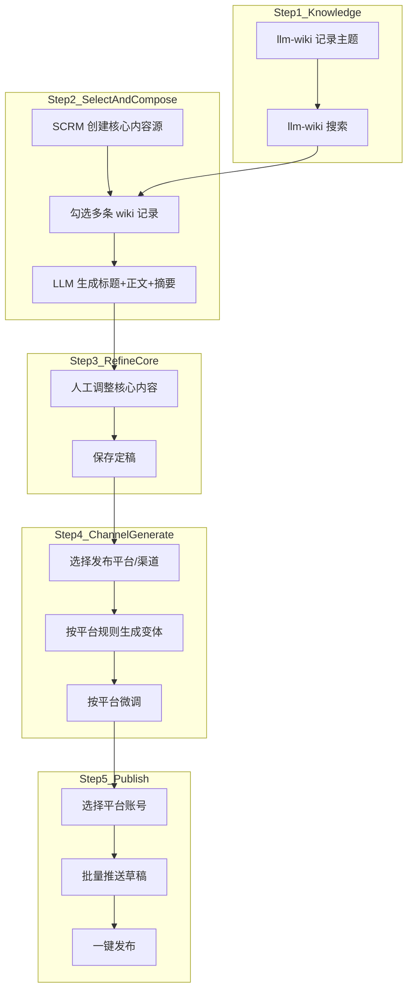
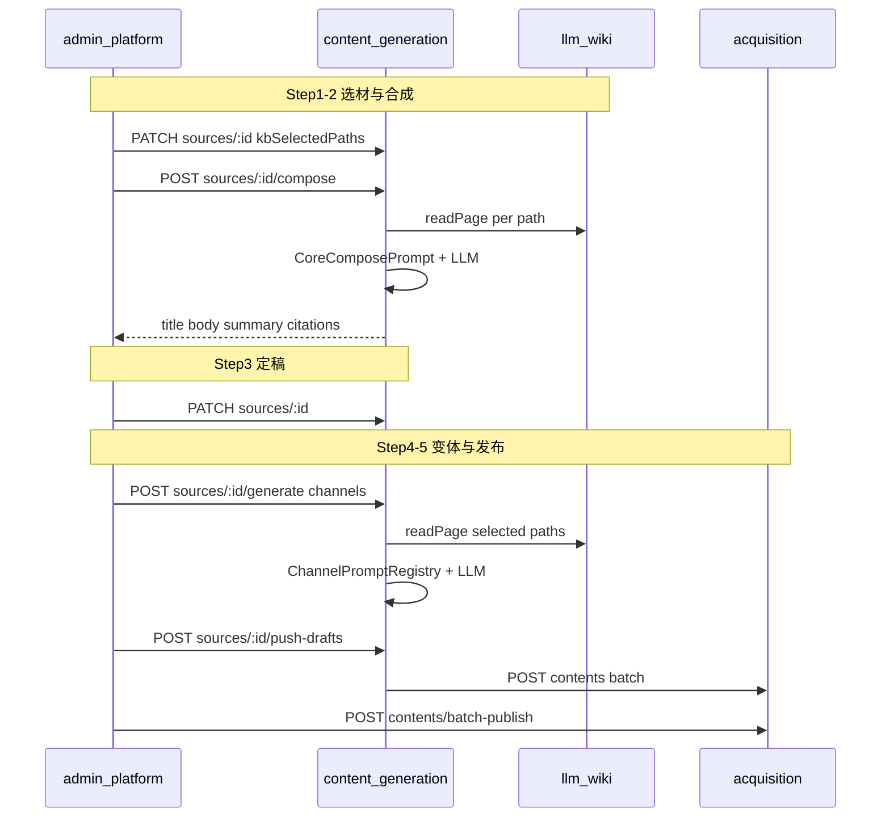
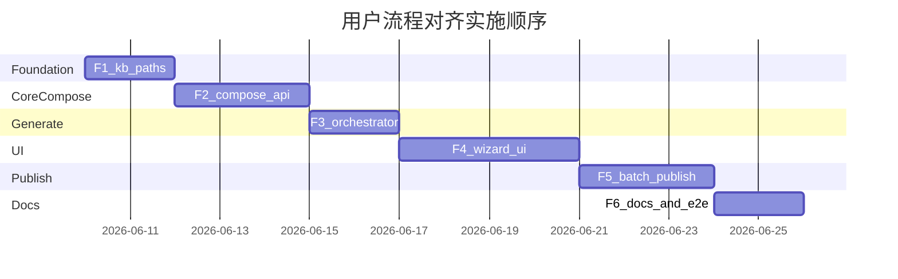

# 内容工坊用户流程对齐计划

> **状态：** 已实施  
> **创建日期：** 2026-06-09  
> **概述：** 基于用户描述的「llm-wiki 选材 → LLM 合成核心稿 → 人工定稿 → 多渠道生成 → 一键发布」流程，对齐产品体验与现有 MVP 实现，补齐两阶段 LLM 生成与向导式 UI。  
> **承接：** [多平台内容生成服务](./2026-06-04-content-generation-service.md) · [AI 原生个人创作中心](./2026-06-05-ai-native-creation-center.md)（P0–P5 主体已完成）

---

## 实施清单

- [x] **F1 选材持久化** — migration + `kb_selected_paths` / `kb_citations` + DTO/entity + PATCH API；KB 搜索多选 UI
- [x] **F2 核心稿合成** — `kb/read-pages` + `sources/:id/compose` + `CoreComposePromptRegistry` + 单测
- [x] **F3 生成链路对齐** — `GenerationOrchestrator` 优先 selected paths + `readPage` 全文 grounding
- [x] **F4 向导 UI** — `ContentStudioEditor` 重构为 4 步向导（选材 → 合成 → 定稿 → 发布）
- [x] **F5 批量发布** — `push-drafts` + acquisition `batch-publish` + 平台账号选择器
- [x] **F6 文档同步** — `docs/facts/studio.md`、API 契约、E2E harness；更新 2026-06-05 交叉引用

> **状态：** 已实施（2026-06-09）

---

## 背景与定位

当前 MVP 验证了 **「手写核心源 → 自动 KB 检索 grounding → 生成变体 → 逐条推送/发布」** 的技术链路，但 **产品流程与用户心智不一致**。本计划以用户描述为准，补齐 **两阶段生成**（核心稿合成 + 平台变体）与 **向导式 UI**。

---

## 目标用户流程（单一事实源）



**核心原则：**

| 原则 | 说明 |
|------|------|
| 知识不复制 | llm-wiki 仍是知识事实源；SCRM 只存 **选中 path 列表** + 合成后的核心稿 |
| 两阶段 LLM | 第一次 LLM：**wiki → 核心稿**；第二次 LLM：**定稿核心稿 → 平台变体** |
| 选材优先于检索 | 用户已选 path 时，**不再**用 title+keywords 做隐式 search |
| 定稿门槛 | 平台变体生成前，核心源须 `body` 非空且用户显式保存 |

---

## 现状 vs 目标（差距矩阵）

| 步骤 | 用户预期 | 当前实现 | 改造 |
|------|----------|----------|------|
| wiki 搜索 | 在 llm-wiki 或 Studio 内搜索 | 侧栏 `kb/search` 只读预览 | 搜索结果可 **多选** |
| 选材持久化 | 选中多条记录绑定到核心源 | 无字段、无 API | 新增 `kb_selected_paths` |
| 合成核心稿 | LLM 根据选中页生成 title/body | 创建空源，手写正文 | 新增 `compose` API + Prompt |
| 读全文 | 基于完整 wiki 页内容 | `readPage` 已实现但未调用；grounding 仅用 snippet | compose/grounding 走 `readPage` |
| 调整核心稿 | 编辑后再生成平台稿 | 有编辑区，但上一步缺失 | 向导 Step 3 |
| 生成平台稿 | 基于 **定稿** 核心内容 | 基于手写源 + 自动 search | orchestrator 改用 selected paths |
| 发布 | 选平台后一键发布 | 逐变体弹窗 push + 逐草稿 publish | 批量 push/publish + 账号选择器 |

---

## 目标架构



---

## 数据模型变更

在 [`content_source`](../../code/services/content-generation-service/src/entity/content-source.entity.ts) 新增：

```sql
-- migration: code/scripts/migrations/2026-06-09-content-source-kb-paths.sql
ALTER TABLE content_source
  ADD COLUMN kb_selected_paths JSONB DEFAULT '[]'::jsonb,
  ADD COLUMN kb_citations JSONB DEFAULT '[]'::jsonb,
  ADD COLUMN compose_status VARCHAR(20) DEFAULT 'draft';
  -- compose_status: draft | composed | finalized
```

| 字段 | 类型 | 用途 |
|------|------|------|
| `kb_selected_paths` | `string[]` JSONB | 用户选中的 llm-wiki 页面 path |
| `kb_citations` | `{path,title,snippet?}[]` JSONB | 选材/合成时的引用快照，供 UI 展示 |
| `compose_status` | enum string | 向导进度与校验（可选，也可用 body 是否为空推断） |

同步更新：entity、DTO（[`content-source.dto.ts`](../../code/services/content-generation-service/src/dto/content-source.dto.ts)）、[`init-db.pg.sql`](../../code/scripts/init-db.pg.sql)。

---

## API 契约（新增 / 扩展）

前缀不变：`/api/v1/content-studio/*`（经 gateway 7010）。

### 1. 读 wiki 页（代理）

```http
POST /api/v1/content-studio/kb/read-pages
{ "paths": ["notes/topic-a.md", "notes/topic-b.md"], "projectId": "current" }
```

实现：[`LlmWikiKbService`](../../code/services/content-generation-service/src/service/llm-wiki-kb.service.ts) 封装已有 [`LlmWikiClient.readPage`](../../code/packages/llm-wiki-client/src/llm-wiki.client.ts)。

### 2. 合成核心稿

```http
POST /api/v1/content-studio/sources/:id/compose
{
  "paths": ["notes/topic-a.md"],
  "tone": "专业",
  "targetAudience": "创作者",
  "instruction": "可选用户补充意图"
}
```

响应：

```json
{
  "title": "...",
  "summary": "...",
  "body": "...",
  "keywords": ["..."],
  "citations": [{ "path": "...", "title": "..." }],
  "composeStatus": "composed"
}
```

行为：读选中页全文 → `CoreComposePromptRegistry` → LLM → **写回** `content_source`（title/body/summary/keywords/kb_citations），返回供 UI 展示。

### 3. 扩展 generate（行为变更，非 breaking）

[`GenerateContentDto`](../../code/services/content-generation-service/src/dto/generation.dto.ts) 保持不变；[`GenerationOrchestrator`](../../code/services/content-generation-service/src/service/generation-orchestrator.service.ts) 逻辑：

```
if source.kb_selected_paths.length > 0:
  kbContext = readPage(每个 path) 拼接
  citations = 来自 selected paths
else if kbEnabled && kbQuery/title/keywords:
  保持现有 search 逻辑（向后兼容）
else:
  无 kb grounding
```

### 4. 批量推送与发布

```http
POST /api/v1/content-studio/sources/:id/push-drafts
{
  "items": [
    { "variantId": 1, "platform": "xiaohongshu", "accountId": 1, "contentType": 1 },
    { "variantId": 2, "platform": "twitter", "accountId": 2, "contentType": 1 }
  ]
}
```

```http
POST /api/v1/acquisition/contents/batch-publish
{ "contentIds": [101, 102] }
```

acquisition 侧在 [`content.controller.ts`](../../code/services/acquisition-service/src/controller/content.controller.ts) 新增；失败时返回逐项结果，不整批 rollback（与单条 publish 一致）。

---

## Prompt 层

新增 [`core-compose-prompt.registry.ts`](../../code/services/content-generation-service/src/prompt/core-compose-prompt.registry.ts)（与现有 [`channel-prompt.registry.ts`](../../code/services/content-generation-service/src/prompt/channel-prompt.registry.ts) 并列）：

- **输入：** 多页 markdown + 可选 tone/audience/instruction
- **输出：** 严格 JSON `{ title, summary, body, keywords[] }`
- **约束：** 必须标注引用来源（path）；不捏造 wiki 中不存在的事实

渠道 Prompt **不变**，继续消费 `PromptSourceContext`；仅 `kbContext` 来源从 search snippet 改为 readPage 全文（当有 selected paths 时）。

---

## UI 改造（向导式）

重构 [`ContentStudioEditor.vue`](../../code/apps/admin-platform/src/views/content-studio/ContentStudioEditor.vue) 为 **4 步向导**（[`ContentStudioList.vue`](../../code/apps/admin-platform/src/views/content-studio/ContentStudioList.vue) 创建后进入）：

| Step | 名称 | 主要交互 |
|------|------|----------|
| 1 | 选材 | KB 搜索 + 多选 checkbox + 已选列表；保存 `kbSelectedPaths` |
| 2 | 合成核心稿 | 「从选中页生成」→ compose API；展示 citations |
| 3 | 定稿 | 编辑 title/summary/body/keywords；保存 |
| 4 | 发布 | 勾选渠道 → 生成变体 → 选平台账号 → 「推送并发布」 |

**发布 Step 改进：**

- 调用 `GET /api/platform-account/list?platform=...`（已有 API，UI 未用）替代手填 accountId
- OAuth token 在账号管理页配置，发布 Step **不再**每次弹 dev-token 输入框
- 草稿列表去掉硬编码 `platform=xiaohongshu` 过滤

可选：拆分子组件 `ContentStudioWizard/` 目录，避免单文件过大。

---

## 分阶段交付

| 阶段 | 范围 | 验收 |
|------|------|------|
| **F1 选材持久化** | migration + DTO/entity + PATCH paths；KB 搜索多选 UI | curl 保存 paths；UI 刷新后仍显示已选 |
| **F2 核心稿合成** | `kb/read-pages` + `compose` API + CoreComposePrompt + 单测 | 给定 2 条 wiki path，mock LLM 返回 title/body |
| **F3 生成链路对齐** | orchestrator 优先 selected paths + readPage | 生成变体 citations 与选中 path 一致，不再依赖 search |
| **F4 向导 UI** | 4 步向导替换现有单页 | 手工走通：选材 → 合成 → 编辑 → 生成 |
| **F5 批量发布** | push-drafts + batch-publish + 账号选择器 | E2E：2 渠道 → 批量 push → 一键 publish（mock） |
| **F6 文档同步** | `docs/facts/studio.md`、API README、harness、本计划状态 | CI type-check + `pnpm test:e2e:content-studio` 绿 |



---

## 测试策略

- **单元测试：** `CoreComposePromptRegistry`、orchestrator selected-path 分支、read-pages 代理
- **API E2E：** 扩展 [`content-studio.spec.ts`](../../code/e2e/tests/content-studio.spec.ts)：
  1. 创建源 → 设置 mock kb paths（或 stub readPage）
  2. compose → 断言 body 非空
  3. generate → 断言 citations 含 path
  4. batch push/publish
- **向后兼容：** 无 `kb_selected_paths` 的旧源仍可按现有 search grounding 生成

---

## 非目标（本计划不做）

- llm-wiki 桌面 App 内改动（用户在 App 内写/搜即可）
- 真实平台 OAuth 跳转（继续 mock/live 双模式，live 按平台逐个接）
- `graph()` 主题扩展（可列为 F7 增强）
- Agent/MCP 触发 compose（文档提及即可，不阻塞主流程）

---

## 与现有文档的关系

| 文档 | 变更 |
|------|------|
| [2026-06-05-ai-native-creation-center.md](./2026-06-05-ai-native-creation-center.md) | 顶部加 **「UI 流程以本计划为准」** 说明；KB 侧栏「一键插入引用」并入 F4 |
| [docs/facts/studio.md](../facts/studio.md) | 更新 sequenceDiagram：增加 compose 步骤；补充新 API |
| [docs/api/content-studio/README.md](../api/content-studio/README.md) | 新增 compose / read-pages / push-drafts 契约 |
| [docs/README.md](../README.md) | 索引追加本计划链接 |

---

## 风险与约束

- **readPage 体量：** 多页全文可能超 LLM context；compose 时限制最多 N 页（建议默认 5）并截断单页字符数
- **llm-wiki 离线：** compose/generate 依赖 readPage 时返回 `503 KB_UNAVAILABLE`，UI Step 1 应阻断
- **Docker 访问宿主机 wiki：** 继续用 `host.docker.internal:19828`（已有配置）
